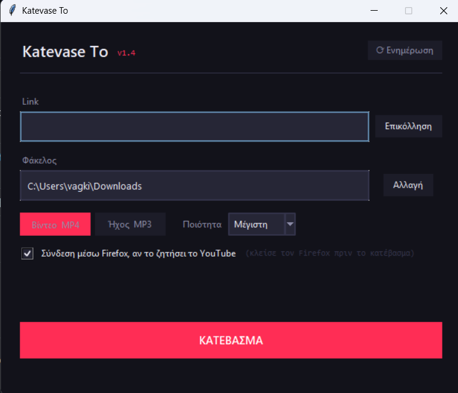

# Katevase To

A desktop YouTube downloader (MP4 video / MP3 audio) built for **non-technical users**. I originally made it for my mum, so the goal was: paste a link, press one button, and never open a terminal.

*"Κατέβασέ το" = "Download it" in Greek. The interface is in Greek.*



## Features

- **Video (MP4)** up to 4K with a quality picker, or **audio only (MP3, 192 kbps)**
- **Self-healing setup:** missing dependencies are detected at startup and installed with one click
  - `yt-dlp` is installed into the *same* Python interpreter that runs the app (`sys.executable`), which avoids the classic "installed it, but into another Python" problem
  - `ffmpeg` is fetched through `imageio-ffmpeg`, with no manual PATH editing
  - a missing Node.js/Deno runtime (needed by yt-dlp for 1080p+) is flagged with a download link
- **Graceful degradation:** without ffmpeg it still works (progressive MP4 up to 720p, M4A audio)
- **Automatic sign-in fallback:** it tries first without cookies. Only if YouTube asks for sign-in ("confirm you're not a bot") does it retry with the local Firefox session cookies
- **Human-readable errors:** yt-dlp exceptions are mapped to plain-language messages that tell the user what to do next
- **One-click yt-dlp update** for when YouTube changes break downloads

## Design notes

- **Thread-safe GUI:** downloads run in a background thread that never touches Tkinter directly. The thread posts messages to a `queue.Queue`, and the main thread polls the queue with `after()` to update the progress bar and status.
- **Why only Firefox for cookies:** Chromium-based browsers (Chrome, Edge, Brave, Opera) now protect cookies with App-Bound Encryption, so external tools can no longer read them.

## Installation

Requires Python 3.9+ on Windows (it should also run on Linux/macOS).

```bash
git clone https://github.com/Vagkiolas/katevase-to.git
cd katevase-to
pip install -r requirements.txt
```

## Usage

Double-click **`Katevase To.bat`**, or run:

```bash
python katevase_to.py
```

1. Paste the link (**Επικόλληση**)
2. Choose **Βίντεο MP4** or **Ήχος MP3**, and a quality
3. Press **ΚΑΤΕΒΑΣΜΑ**. Files are saved to `Downloads` by default.

A standalone Windows `.exe` (no Python needed) is available under [Releases](https://github.com/Vagkiolas/katevase-to/releases).

## Version history

| Version | Changes |
|---|---|
| **v1.4** | Automatic Firefox-cookie retry; cookie checkbox replaces browser list; fixed quality menu vanishing after MP3 ↔ MP4 toggle |
| **v1.3** | Node.js/Deno detection for 1080p+; notice panel for missing tools; progress-bar layout fix; `.bat` launcher |
| **v1.2** | MP4/MP3 downloads, quality selection, auto-install of yt-dlp & ffmpeg, friendly errors |

## Built with

Python · Tkinter · [yt-dlp](https://github.com/yt-dlp/yt-dlp) · FFmpeg (via [imageio-ffmpeg](https://github.com/imageio/imageio-ffmpeg)) · PyInstaller

## Disclaimer

For personal use only. Please respect YouTube's Terms of Service and the rights of content creators.
